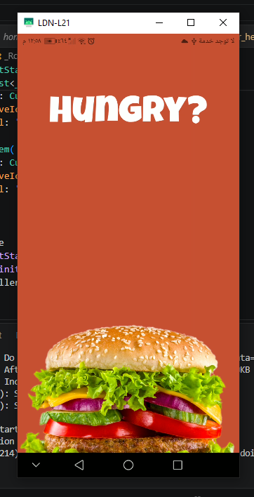
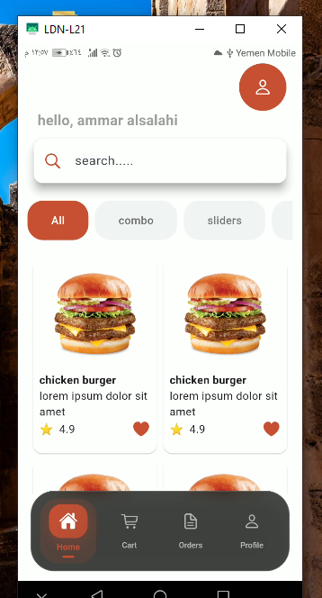
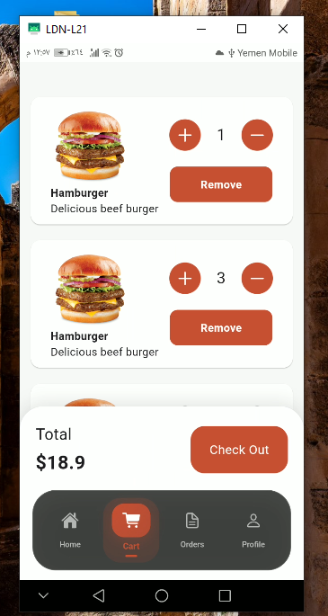
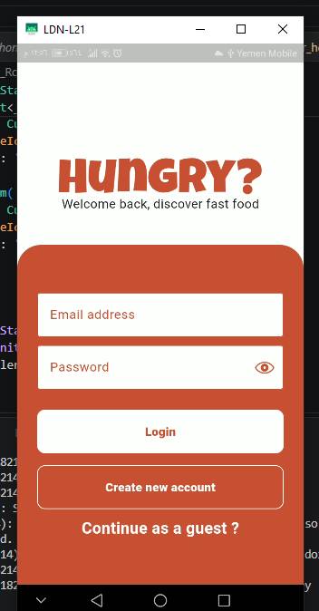
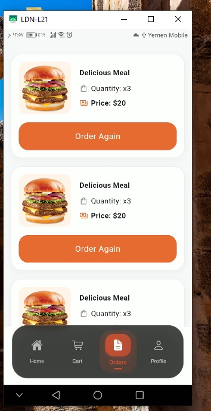
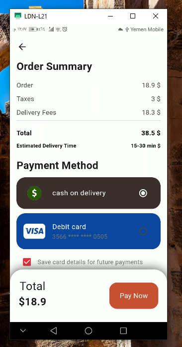
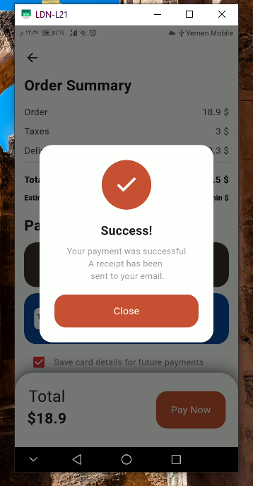
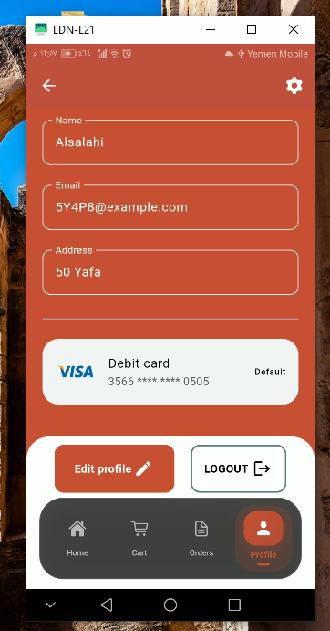

# 🍔 Hungry – Food Ordering App UI

A modern and user-friendly food ordering application built with **Flutter** and **Dart**. Hungry focuses on delivering a clean interface, smooth navigation, and an enjoyable mobile shopping experience.

## 📱 Screenshots

<p align="center">
  
  
  
  
  
  
  
  
</p>

## ✨ Features

- **Home Screen:** Browse food items through a clean and attractive interface.
- **Shopping Cart:** View and manage selected items.
- **Order History:** View previous orders.
- **Profile Screen:** Access user profile information.
- **Modern Navigation:** Custom glassmorphism-inspired bottom navigation bar.
- **Responsive UI:** Designed to provide a consistent experience across different screen sizes.
- **Reusable Components:** Organized UI components for easier maintenance and development.

## 🛠️ Tech Stack

| Technology | Purpose |
|---|---|
| Flutter | Cross-platform UI development |
| Dart | Application programming language |
| Material Design | UI components and styling |
| Git & GitHub | Version control |

## 📂 Project Structure

```text
lib/
├── core/
│   └── constants/
├── features/
│   ├── home/
│   ├── cart/
│   ├── orderHistory/
│   └── auth/
└── main.dart
```

*Note: Adjust this structure to match the actual project folders.*

## 🚀 Getting Started

### Prerequisites

- Flutter SDK
- Dart SDK
- Android Studio or Visual Studio Code

### Installation

1. Clone the repository:

```bash
git https://github.com/ammaralsalahi/Hungry-app.git
```

2. Navigate to the project directory:

```bash
cd hungry
```

3. Install dependencies:

```bash
flutter pub get
```

4. Run the application:

```bash
flutter run
```

## 🎯 Project Goals

Hungry was developed as a practical Flutter UI project to improve mobile application development skills, explore modern interface design, and build reusable components with a focus on user experience.

## 👨‍💻 Developer

**Ammar Yaser Alsalahi**

- GitHub: [@ammaralsalahi](https://github.com/ammaralsalahi)
- LinkedIn: [Ammar Yaser Alsalahi](https://www.linkedin.com/in/ammar-yaser-alsalahi-1ab8bb379/)

---

<p align="center">
  <b>Built with Flutter ❤️</b>
</p>
